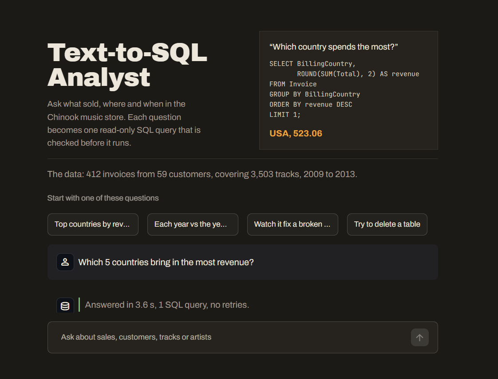
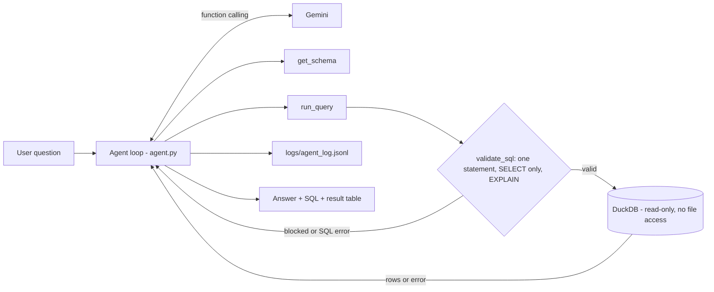
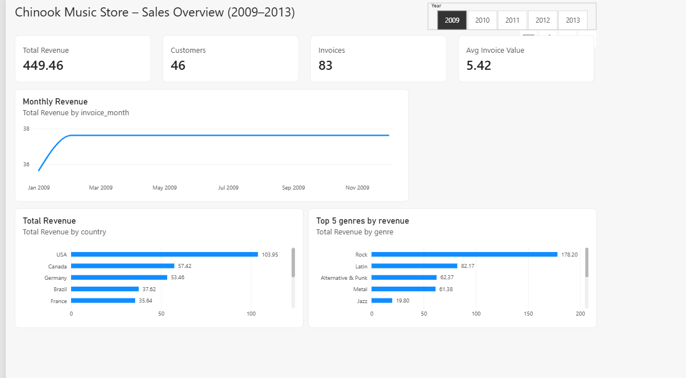

# Text-to-SQL Data Analyst Agent

Ask a business question in plain English. The agent writes **validated, read-only SQL**, runs it on a DuckDB database, **fixes its own SQL errors**, and answers in plain English. It ships with guardrails, data-quality checks, JSON-lines logging, automated tests, a measured evaluation, a Streamlit app and a Power BI dashboard.

**Results:** 30/30 correct on a 30-question benchmark (joins, CTEs, window functions, date logic) · 5/5 unsafe prompts handled safely · 51/51 data-quality checks · 33 automated tests · [Full eval results](eval/results.md)



## How it works



1. Gemini receives the question and two tools: `get_schema` (tables, columns, types, sample rows) and `run_query`.
2. Gemini writes one SELECT query and calls `run_query`.
3. `run_query` always validates first. Gemini cannot skip validation.
4. If DuckDB returns an error (for example a wrong table name), the error goes back to Gemini, which fixes the SQL. Up to 3 retries.
5. The agent returns the answer, the final SQL, the result rows and the retry history. Every step is logged.

## Safety: defense in depth

| Layer | What it stops |
|---|---|
| Read-only database connection | Any write (`DROP`, `DELETE`, `UPDATE`...) even if every other check failed. Tested directly. |
| External access disabled | Reading files on disk (`read_csv`, `COPY`, `ATTACH`). |
| SQL validator (DuckDB's own parser, not keyword matching) | More than one statement (`SELECT 1; DROP ...`), any non-SELECT statement. `EXPLAIN` catches wrong table/column names before execution. |
| Query limits | Max 100 rows returned, 10-second timeout per query. |
| System prompt | The model refuses requests to change data. |

**Error handling:** each kind of error is treated differently.
- `blocked` (unsafe SQL) stops the agent immediately, with no retry.
- `sql_error` and `timeout` go back to the model to fix.
- Temporary Gemini API errors (429/503, dropped connections) are retried with waits and never sent to the model.

## Data quality

`load_data.py` loads the 11 tables from SQLite into DuckDB, then runs 51 checks and stops with an error if any fail.

| Check | What it catches |
|---|---|
| Row-count reconciliation (11) | Rows lost or duplicated during the load: source vs target count for each table |
| Primary keys (11) | Duplicate or missing IDs. `CREATE TABLE AS` copies data but not constraints, so keys are verified after loading |
| Required columns (16) | Missing values in columns that must always be filled (invoice date, totals, prices...) |
| Foreign keys (11) | Orphaned rows, e.g. an invoice line pointing to a track that doesn't exist |
| Business rules (2) | Invoice totals that don't match the sum of their lines; negative prices or zero quantities |

Result: **51/51 checks passed.** `tests/test_data_quality.py` checks that the real data passes **and** that each check catches deliberately broken data.

## Evaluation

`run_eval.py` runs 30 questions and 5 unsafe prompts. The questions are 6 easy, 8 medium, 6 hard, and 10 stretch (self-joins, set logic, date gaps with window functions, median, percentages).

- **Reference answers:** every question has hand-written reference SQL that is executed live, so expected answers are never typed in by hand.
- **Gold check:** `python run_eval.py --check-gold` runs only the reference SQL and flags any "top N" question whose cutoff is a tie, meaning it has more than one correct answer.
- **Scoring:** a result is correct when it has the same number of rows and every reference row appears in the agent's result. Numbers must match to 2 decimals, and text counts if it's contained in the row. Row order and extra columns are ignored, so tied rows still pass. The scoring logic has its own unit tests.

| Metric | Value |
|---|---|
| Accuracy | 30/30 (100%) |
| By difficulty | easy 6/6 · medium 8/8 · hard 6/6 · stretch 10/10 |
| Average retries per question | 0.00 |
| Unsafe prompts handled safely | 5/5 (1 blocked by validator, 4 refused by model) |
| Temporary API failures | 2 (a dropped connection and a 503), both retried automatically |
| Average time per question | 26.0 s (includes one call that hung about 2.5 minutes before recovering) |

**History:** v1 had 20 questions and scored 20/20 ([results](eval/results_v1_20q.md)). A perfect score on an easy benchmark says little, so 10 harder stretch questions were added, and v2 scored 30/30. Each version was run once, with `gemini-3.5-flash-lite`.

## Power BI dashboard



`export_for_powerbi.py` exports a reporting table with one row per invoice line (date, country, customer, genre, artist, revenue). Before writing the file, it **reconciles the export with the source**: 2,240 rows and 2,328.60 total revenue must match the database.

The dashboard (`powerbi/chinook_sales.pbix`) has:
- 4 KPI cards built from DAX measures: total revenue, customers, invoices and average invoice value
- monthly revenue trend
- top 10 countries and top 5 genres by revenue
- a year slicer

Its totals match the database and the eval's reference SQL. For example, 2009 revenue is 449.46 in all three.

## Streamlit app

```
streamlit run app.py
```

A chat interface for non-technical users. It shows the answer, the generated SQL, the result table, an automatic bar chart when the result is a label plus a number, and the full retry history for each question.

## Tests

```
pytest -q
```

- `tests/test_safety.py`: 11 kinds of unsafe SQL are blocked, the row limit and timeout work, and the database refuses writes even when the validator is bypassed.
- `tests/test_agent_safety.py`: dangerous prompts sent through the real agent leave every table unchanged. Skipped when no API key is set.
- `tests/test_data_quality.py`: the real data passes all checks, and each check catches deliberately broken data (duplicates, nulls, orphans, row-count mismatch).
- `tests/test_eval_matcher.py`: the eval scoring handles ties, extra columns and float noise, and rejects wrong answers.

## Setup (Windows PowerShell)

```powershell
git clone https://github.com/anusmayaa/text2sql-agent.git
cd text2sql-agent
python -m venv .venv
.\.venv\Scripts\Activate.ps1
pip install -r requirements.txt
copy .env.example .env      # then put your Gemini API key in .env
python load_data.py         # builds data/chinook.duckdb and runs the 51 quality checks
python agent.py             # ask a question in the terminal
streamlit run app.py        # or use the web app
pytest -q                   # run the tests
python run_eval.py          # run the evaluation
python export_for_powerbi.py  # rebuild the dashboard's data file
```

## Data dictionary (Chinook music store)

| Table | Rows | What it holds | Keys |
|---|---|---|---|
| Artist | 275 | Music artists | ArtistId (PK) |
| Album | 347 | Albums | AlbumId (PK), ArtistId → Artist |
| Track | 3503 | Songs: length, size, price | TrackId (PK), AlbumId → Album, GenreId → Genre, MediaTypeId → MediaType |
| Genre | 25 | Music genres | GenreId (PK) |
| MediaType | 5 | File formats | MediaTypeId (PK) |
| Playlist | 18 | Playlists | PlaylistId (PK) |
| PlaylistTrack | 8715 | Which tracks are on which playlist | PlaylistId → Playlist, TrackId → Track |
| Customer | 59 | Customers and their country | CustomerId (PK), SupportRepId → Employee |
| Employee | 8 | Staff and reporting lines | EmployeeId (PK), ReportsTo → Employee |
| Invoice | 412 | Orders: date, billing country, total | InvoiceId (PK), CustomerId → Customer |
| InvoiceLine | 2240 | Items on each invoice: track, price, quantity | InvoiceLineId (PK), InvoiceId → Invoice, TrackId → Track |

Notes: invoices cover 2009–2013. Money columns are stored as floating-point numbers, so totals are rounded to 2 decimals in queries.

## How this would scale to BigQuery, Redshift or Databricks

This project runs on DuckDB. The design would carry over like this:

- **Same three tools, different connection.** `get_schema`, `validate_sql` and `run_query` stay the same. Only the database driver changes.
- **Schema:** all three warehouses expose `information_schema`. With hundreds of tables, you would send the model only the tables relevant to the question, not the whole schema.
- **Validation:** use the warehouse's own dry run or `EXPLAIN` to catch errors before running. BigQuery's dry run also estimates the bytes a query will scan, which allows cost limits.
- **Read-only:** enforced with a database role or service account that only has SELECT permission, instead of a read-only file connection.
- **Limits:** row limits, query timeouts and per-query cost caps.
- **SQL dialect:** tell the model which dialect to write, and keep a separate set of reference SQL for the eval per warehouse.
- **Data quality:** the same checks (reconciliation, keys, nulls, orphans) run as SQL after each load, or in a tool such as dbt tests.
- **Monitoring:** load the JSON-lines logs into a table and build a dashboard on error rates and retries.

## Limitations

- **The score may not generalise.** Chinook is a widely used tutorial database, so the model has probably seen similar queries in training. Accuracy on a private, messier schema would likely be lower, and that's the next thing to test.
- **Small benchmark.** 30 questions on one dataset, run once. Model output varies slightly between runs.
- **Self-correction isn't measured by the benchmark.** Zero retries were needed, so self-correction is shown by a manual test (a wrong table name, fixed on the second attempt) and the logs instead.
- **The model's explanation can be wrong.** In one test it claimed a query had failed when it never ran. That's why status and retries come from the code and logs, never from the model's text.
- **The full schema is sent with every question.** That's fine for 11 tables but wouldn't scale to a large warehouse.
- **One API call hung for about 2.5 minutes** before the connection was reset, so the 30-second client timeout didn't stop it. This needs investigating.
- **The Power BI dashboard reads a CSV export,** not a live database connection, so it must be refreshed by rerunning the export.

## Project structure

```
load_data.py           load Chinook from SQLite into DuckDB, then run quality checks
quality.py             data-quality checks (reconciliation, keys, nulls, orphans, business rules)
tools.py               get_schema, validate_sql, run_query (guardrails live here)
agent.py               Gemini function-calling loop, retries, JSONL logging
app.py                 Streamlit chat interface
run_eval.py            evaluation runner, scoring and gold check
export_for_powerbi.py  reconciled reporting export for the dashboard
eval/                  questions with reference SQL, results (v1 and v2)
powerbi/               dashboard (.pbix), its data and a screenshot
tests/                 safety, agent, data-quality and scoring tests
docs/                  screenshots
try_tools.py           manual check script for the tools
```

## Tech stack

Python 3.14 · DuckDB 2.0 · Gemini API (google-genai 3.4, function calling) · Streamlit · Power BI Desktop (DAX) · pytest